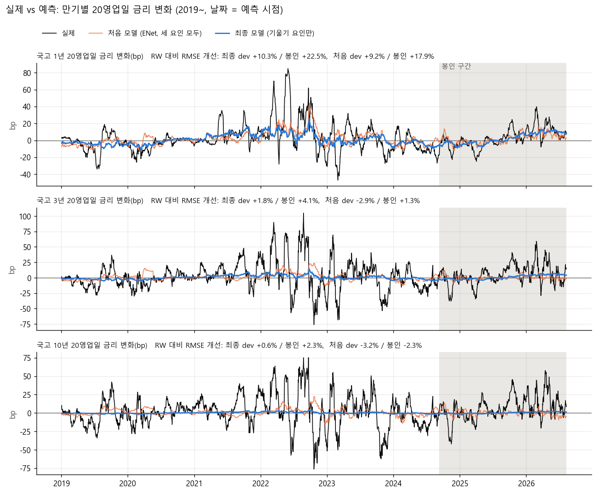
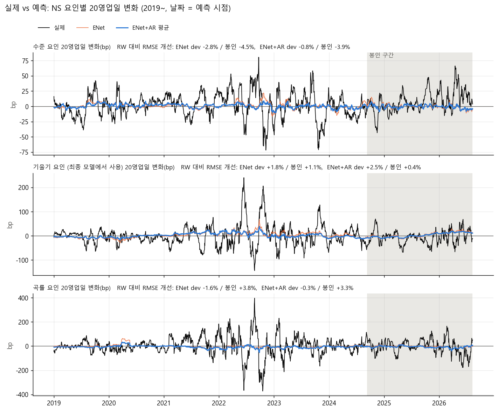

# 금리커브 예측 개선 실험

**결론:** 기울기 요인만 예측하고 수준과 곡률은 0(RW)으로 두는 설정이 가장 나았다. 국고 1년 20영업일 예측은 RW 대비 RMSE를 유의하게 줄였고(봉인 구간 +22.3%, DM p=0.005), 3년 이상은 RW와 비슷한 수준이다. 모델 교체(딥러닝 포함), 표본 확장, 미국 금리 특징은 이 설정을 넘지 못했다.

**공통 조건**

| 항목 | 내용 |
|---|---|
| 예측 대상 | NS 요인(수준, 기울기, 곡률)의 20영업일 변화. 만기별 금리 변화로 복원해 평가 |
| 평가 지표 | RW(변화 0) 대비 RMSE 개선율(%). +면 RW보다 정확 |
| 검증 | expanding walk-forward, 20영업일마다 재학습(딥러닝 60일), 정답이 확정된 행만 학습(purge) |
| dev 구간 | 2019-01-01 ~ 2024-09-07. 방안 선택에 사용 |
| 봉인 구간 | 2024-09-08 ~ 2026-09-08. 확인용 |

## 1. 사용 데이터

| 데이터 | 출처 | 기간 | 항목 | 사용 실험 |
|---|---|---|---|---|
| 한국 국고채 금리 | 한국은행 ECOS | 2010~ | 1, 2, 3, 5, 10, 20, 30년 (NS 7만기) | 1차, 2차, 딥러닝, 최종 |
| 한국 국고채 금리 (확장) | 한국은행 ECOS | 2001~ | 1, 3, 5, 10년 (NS 4만기) | 표본 확장, 미국 특징 |
| 한국 단기금리, 기준금리 | 한국은행 ECOS | 1999~ | CD 91일, CP 91일, 통안 1년, 콜, 기준금리 | 전 실험 |
| 미국 국채 금리 | FRED (DGS1, 3, 5, 10) | 1962~ | 1, 3, 5, 10년 | 표본 확장, 미국 특징 |

## 2. 피처

| 피처 세트 | 구성 | 개수 |
|---|---|---|
| 요인 자기 4개 | 해당 요인의 레벨, 5일 변화, 20일 변화, 60일 z점수 | 4 |
| 요인 자기 12개 | 위 4개를 세 요인 모두에 대해 | 12 |
| 기본 | 요인 자기 12개 + CD-통안 스프레드, CP-CD 스프레드, 국고1년-기준금리 갭, 국고3년 20일 변동성 | 16 |
| 확장 | 기본 + 요인별 60일/120일 변화, 500일 백분위 + 갭 20일/60일 변화, CD-통안 20일 변화, 1s10s, 3-5-10 버터플라이, 콜-기준금리 갭, 기준금리 60일 변화 | 32 |
| 기본 + 미국 전일 | 기본 + 미국 1/3/10년 금리 1일, 5일, 20일 변화, 미국 10y-1y 20일 변화. 한국 t일에는 달력상 t-1일 이전 미국 종가만 사용 | 26 |

## 3. 모델

| 모델 | 설정 |
|---|---|
| AR | 선형회귀, 요인 자기 4개만 사용 |
| ENet | ElasticNetCV (l1_ratio 0.1/0.5/0.9, 5-fold) |
| Ridge, Huber, PLS | RidgeCV(α 1~10⁴), Huber(α=10), PLS 2성분 |
| GBM | GradientBoosting, 깊이 2, 80트리, 학습률 0.03 |
| LSTM | 은닉 32, dropout 0.3, 최근 40일 시퀀스 입력, 3요인 동시 출력, 시드 3개 평균, 조기종료 |
| 1D-CNN | Conv 2층(32채널, dilation 2), 이하 LSTM과 동일 |
| MLP | 은닉 64, 당일 피처만 입력, 이하 LSTM과 동일 |
| 후처리 | 요인별 예측에 배수를 곱함. "기울기만 사용" = 수준과 곡률 예측을 0으로 둠 |

## 4. 결과

### 4-1. 모델, 피처, 후처리 비교 (한국 2010~, NS 7만기)

단위: RW 대비 RMSE 개선율(%).

| 단계 | 모델 | 피처 | 1년 dev | 3년 dev | 10년 dev | 1년 봉인 | 3년 봉인 | 10년 봉인 |
|---|---|---|---|---|---|---|---|---|
| 1차 | ENet | 기본 | +9.2 | -2.9 | -3.2 | +17.9 | +1.3 | -2.3 |
| 1차 | AR | 요인 자기 4개 | -0.5 | -2.1 | -1.3 | +11.9 | +0.3 | -3.1 |
| 1차 | ENet, 예측 ×0.5 | 기본 | +7.2 | -0.7 | -1.0 | +11.9 | +1.1 | -0.7 |
| 1차 | Ridge | 기본 | +3.7 | -8.1 | -5.7 | +17.4 | +4.5 | -3.1 |
| 1차 | Huber | 기본 | +5.9 | -8.1 | -7.5 | +17.0 | +2.2 | -4.2 |
| 1차 | PLS 2성분 | 기본 | -5.3 | -13.3 | -9.0 | +13.8 | -2.2 | -6.6 |
| 1차 | ENet | 확장 | -0.3 | -2.2 | -2.1 | +9.8 | -0.3 | -1.0 |
| 1차 | Ridge | 확장 | -5.3 | -20.2 | -26.0 | +28.2 | +16.3 | +4.5 |
| 1차 | ENet, 최근 3년만 학습 | 기본 | -8.5 | -8.4 | -4.0 | -33.0 | -11.5 | -6.1 |
| 1차 | ENet, 최근 5년만 학습 | 기본 | -3.4 | -5.4 | -2.0 | +14.2 | -2.7 | +4.9 |
| 1차 | ENet+AR 평균 | 기본 | +9.2 | -0.8 | -1.3 | +20.5 | +2.5 | -1.9 |
| 1차 | GBM | 기본 | +2.6 | -6.1 | -4.4 | +1.7 | -1.3 | -3.6 |
| 1차 | Ridge, 예측 ×0.5 | 확장 | +2.4 | -5.6 | -7.3 | +22.2 | +11.2 | +4.8 |
| 1차 | Huber | 확장 | +2.6 | -17.6 | -23.3 | +25.7 | +12.3 | +1.2 |
| 2차 | ENet+AR 평균, 수준=0 | 기본 | +8.0 | +0.1 | -0.2 | +18.1 | +1.8 | +0.5 |
| 2차 | **ENet+AR 평균, 기울기만 사용** | 기본 | +10.3 | +1.8 | +0.6 | +22.5 | +4.1 | +2.3 |
| 2차 | ENet+AR 평균, 예측 ×0.7 | 기본 | +7.9 | -0.1 | -0.6 | +16.1 | +2.1 | -1.1 |
| 2차 | ENet+AR 평균, 수준 ×0.5 | 기본 | +9.2 | -0.1 | -0.5 | +20.4 | +2.6 | -0.4 |
| 2차 | ENet+AR 평균, 수준만 사용 | 기본 | +1.5 | -0.9 | -1.0 | -2.8 | -0.7 | -2.8 |
| 딥러닝 | LSTM | 기본 (40일 시퀀스) | +4.0 | -0.4 | -0.6 | +14.2 | +2.4 | +1.0 |
| 딥러닝 | LSTM, 기울기만 사용 | 기본 (40일 시퀀스) | +6.8 | +1.2 | +0.6 | +12.8 | +1.8 | +1.3 |
| 딥러닝 | 1D-CNN | 기본 (40일 시퀀스) | +5.0 | 0.0 | -0.7 | +12.0 | -1.7 | -3.9 |
| 딥러닝 | 1D-CNN, 기울기만 사용 | 기본 (40일 시퀀스) | +7.5 | +0.3 | +0.1 | +15.7 | +5.6 | +3.5 |
| 딥러닝 | MLP | 기본 | +1.3 | -3.5 | -3.0 | +13.3 | +0.7 | -1.8 |
| 딥러닝 | MLP, 기울기만 사용 | 기본 | +5.6 | +0.2 | +0.5 | +15.7 | +2.9 | +2.2 |

### 4-1-1. 요인별 예측 성과 (같은 실험, 요인 자체의 20영업일 변화)

단위: RW 대비 RMSE 개선율(%). 세 요인은 각각 별도 모델로 예측했다.

| 모델 | 피처 | 수준 dev | 수준 봉인 | 기울기 dev | 기울기 봉인 | 곡률 dev | 곡률 봉인 |
|---|---|---|---|---|---|---|---|
| ENet | 기본 | -2.8 | -4.5 | +1.8 | +1.1 | -1.6 | +3.8 |
| AR | 요인 자기 4개 | -0.4 | -4.2 | +1.5 | -1.4 | +0.1 | +2.0 |
| ENet, 예측 ×0.5 | 기본 | -0.8 | -1.7 | +1.8 | +2.7 | -0.5 | +2.2 |
| Ridge | 기본 | -4.0 | -6.6 | -0.7 | -4.7 | -7.9 | +8.5 |
| Huber | 기본 | -6.5 | -6.2 | -0.3 | -0.7 | -6.1 | +11.8 |
| PLS 2성분 | 기본 | -6.2 | -7.8 | +1.6 | -1.3 | -7.3 | +5.0 |
| ENet | 확장 | -2.1 | -2.8 | -0.9 | -2.8 | -0.2 | +1.7 |
| Ridge | 확장 | -30.9 | -4.8 | -19.7 | +0.9 | -22.1 | +7.9 |
| ENet, 최근 3년만 학습 | 기본 | -3.7 | -2.2 | -4.6 | -28.3 | -9.9 | -8.5 |
| ENet, 최근 5년만 학습 | 기본 | -1.6 | +3.4 | -0.8 | +2.7 | -7.4 | -16.3 |
| ENet+AR 평균 | 기본 | -0.8 | -3.9 | +2.5 | +0.4 | -0.3 | +3.3 |
| GBM | 기본 | -2.4 | -5.3 | -1.9 | +4.8 | -5.6 | +1.9 |
| Ridge, 예측 ×0.5 | 확장 | -8.4 | -0.2 | -5.5 | +5.0 | -6.9 | +6.3 |
| Huber | 확장 | -27.4 | -6.4 | -16.3 | +0.6 | -18.6 | +11.2 |
| LSTM | 기본 (40일 시퀀스) | -1.4 | -0.7 | +1.4 | +1.8 | -0.2 | +0.8 |
| 1D-CNN | 기본 (40일 시퀀스) | -2.3 | -3.7 | +4.0 | -8.3 | +0.6 | +4.3 |
| MLP | 기본 | -3.8 | -2.9 | +2.4 | -0.7 | -0.1 | +3.2 |

| 요인 | 결과 | 최종 설정에서 처리 |
|---|---|---|
| 수준 | 17개 중 16개가 dev와 봉인 모두 음수. 예외(최근 5년 학습)도 dev는 −1.6% | 예측하지 않음(0) |
| 기울기 | ENet, AR, ENet+AR 평균이 dev에서 +1.5~2.5%로 작지만 양수 | ENet+AR 평균 사용 |
| 곡률 | dev는 17개 모두 +0.6% 이하, 봉인은 17개 중 15개가 +0.8~11.8% | 예측하지 않음(0). 최근 2년에만 나타난 결과라 dev 기준을 유지했고, 데이터가 쌓이면 재검토 |

기울기 요인 자체의 개선은 2% 안팎이고, 1년물 금리의 개선은 10~22%다. 기울기 요인의 NS 로딩이 단기물에서 가장 높기 때문으로 추정한다. 분해해서 확인하지는 않았다.

### 4-2. 표본 확장과 미국 금리 특징 (NS 4만기)

만기 구성을 1, 3, 5, 10년으로 고정해 학습 기간만 다르게 비교했다. 2013년 dev는 2001~ 학습에서만 계산할 수 있다.

| 학습 데이터 | 피처 | 모델 | 1년 dev | 3년 dev | 10년 dev | 1년 봉인 | 3년 봉인 | 10년 봉인 | 1년 dev(2013~) |
|---|---|---|---|---|---|---|---|---|---|
| 한국 2010~ | 기본 | ENet+AR 평균 | +1.3 | -3.8 | -2.1 | +10.8 | -1.0 | -4.6 | - |
| 한국 2010~ | 기본 | ENet+AR 평균, 기울기만 사용 | +6.9 | +1.3 | +0.3 | +21.5 | +5.0 | +1.8 | - |
| 한국 2001~ | 기본 | ENet+AR 평균 | -6.9 | -6.0 | -1.5 | +0.0 | -6.3 | -4.6 | -7.1 |
| 한국 2001~ | 기본 | ENet+AR 평균, 기울기만 사용 | +11.3 | +2.5 | +0.7 | +17.7 | +3.0 | +1.0 | +9.1 |
| 한국 2010~ | 요인 자기 12개 | ENet+AR 평균 | +1.4 | -3.0 | -1.3 | +14.8 | -0.5 | -4.2 | - |
| 한국 2010~ | 요인 자기 12개 | ENet+AR 평균, 기울기만 사용 | +6.2 | +0.7 | +0.1 | +20.5 | +4.3 | +1.7 | - |
| 한국 2001~ | 요인 자기 12개 | ENet+AR 평균 | -4.8 | -6.5 | -1.8 | +5.2 | -5.0 | -4.4 | -5.7 |
| 한국 2001~ | 요인 자기 12개 | ENet+AR 평균, 기울기만 사용 | +11.7 | +1.2 | +0.2 | +20.3 | +4.1 | +1.4 | +9.9 |
| 한국 2001~ + 미국 1962~ | 요인 자기 12개 | ENet+AR 평균 | +6.4 | -0.1 | -0.2 | +12.9 | +1.9 | +0.4 | +5.1 |
| 한국 2001~ + 미국 1962~ | 요인 자기 12개 | ENet+AR 평균, 기울기만 사용 | +9.5 | +0.7 | +0.0 | +15.3 | +2.6 | +0.8 | +7.9 |
| 한국 2001~ | 기본 + 미국 전일 | ENet+AR 평균 | -8.3 | -6.5 | -1.5 | -0.6 | -6.3 | -4.6 | -8.0 |
| 한국 2001~ | 기본 + 미국 전일 | ENet+AR 평균, 기울기만 사용 | +11.3 | +2.3 | +0.7 | +17.4 | +2.9 | +1.0 | +9.6 |
| 한국 2010~ | 기본 + 미국 전일 | ENet+AR 평균 | +1.6 | -3.8 | -2.2 | +8.4 | -2.3 | -4.9 | - |
| 한국 2010~ | 기본 + 미국 전일 | ENet+AR 평균, 기울기만 사용 | +8.0 | +1.6 | +0.4 | +19.4 | +3.7 | +1.3 | - |

### 4-3. 최종 설정 (기울기만 사용, 봉인 구간)

DM p는 Diebold-Mariano 검정(Newey-West 분산), 방향정확도는 겹치지 않는 20일 구간 기준.

| 만기 | 20일 개선율 | DM p | 방향정확도 | 5일 개선율 | 5일 DM p |
|---|---|---|---|---|---|
| 1년 | +22.3 | 0.005 | 73.9% | +7.8 | 0.025 |
| 2년 | +6.4 | 0.113 | 60.9% | +1.1 | 0.519 |
| 3년 | +4.1 | 0.141 | 57.4% | +0.6 | 0.591 |
| 5년 | +3.3 | 0.066 | 57.4% | +0.6 | 0.392 |
| 10년 | +2.3 | 0.023 | 63.9% | +0.5 | 0.132 |
| 20년 | +1.3 | 0.018 | 65.2% | +0.3 | 0.063 |
| 30년 | +0.9 | 0.017 | 65.9% | +0.2 | 0.049 |

2013~2024 확장 평가(한국 2001~ 학습, 겹치지 않는 20일 구간 144개)에서 1년물은 RW 대비 +9~10%, 방향 적중 63~64%(이항검정 p<0.001)였다.

## 5. 해석

| 관찰 | 해석 |
|---|---|
| 1년물만 개선 폭이 10~22% | 1년물은 기준금리 기대에 따라 움직여 국내 커브와 단기금리 정보로 예측된다 |
| 수준과 곡률 예측을 빼면 3~10년물이 개선 | 두 요인의 예측은 방향을 맞히는 효과보다 오차를 더하는 효과가 컸다 |
| 확장 피처, Ridge/Huber의 dev와 봉인 결과 부호가 반대 | 독립 표본(dev 약 70개)에 비해 피처가 많아 과적합 |
| 딥러닝이 선형보다 못함 | 파라미터 수에 비해 독립 표본이 적어 과적합. 표본을 늘려도(2001~, 미국 합동) 3~10년물은 개선되지 않음 |
| 미국 전일 금리 효과 0~1%p | 미국 금리의 과거 변화는 한국 금리의 20일 뒤 변화를 설명하지 못함 |

## 6. 실제 vs 예측 시계열

2019년부터 같은 조건(walk-forward, purge)으로 다시 계산한 예측이다. 날짜는 예측 시점이고, 값은 그 시점부터 20영업일 동안의 변화다. 회색 음영이 봉인 구간이다.

| 관찰 | 내용 |
|---|---|
| 예측 폭 | 예측값의 변동 폭이 실제의 일부에 그친다. 크기보다 방향을 참고해야 한다 |
| 1년물 | 2022년 금리 인상기와 2025~2026년 상승기에 예측이 실제와 같은 방향으로 움직였다 |
| 3년, 10년물 | 최종 모델 예측이 0 근처에 머문다. 처음 모델은 2020년, 2022년에 실제와 다른 방향으로 움직인 구간이 있다 |

## 7. 한계

최종 설정은 dev 구간에서 선택했지만 같은 단계에서 봉인 구간 결과도 함께 확인했다. 1년물 유의성은 봉인 구간과 무관한 2013~2024 구간에서도 확인했다. 10~30년물 DM p는 0.05 아래지만 개선 폭이 1~2%이고 dev 구간에서는 유의하지 않아 예측력이 있다고 결론 내리지 않는다.

재현: `python -m src.experiments.curve_ideas` (1차), `curve_ideas2` (2차), `curve_deep`, `curve_more_data`, `curve_us_signal`. 확장 원자료는 `data/raw_ext/`.
