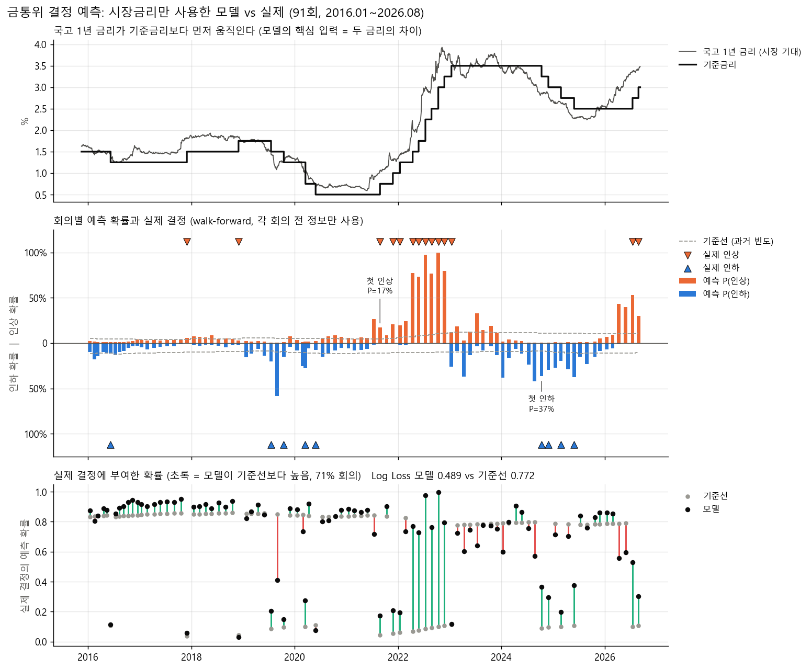

# 연구 계획: 한국 국고채 커브 예측과 금통위 텍스트 분석

작성일: 2026-11-10. 현재 프로젝트 결과를 학술 논문으로 발전시키기 위한 계획 초안.

## 1. 현재 위치

| 항목 | 결과 | 출처 |
|---|---|---|
| 국고 1년 20영업일 예측 | RW 대비 RMSE +22.3%(봉인 구간, DM p=0.005), dev(2019~2024.9) +10.3% | `reports/curve_experiments.md` 4-3 |
| 국고 1년 방향 적중 | dev 66%(이항 p=0.004), 봉인 75%(p=0.011), 2013~2024 확장 평가 63~64%(p<0.001) | 같은 리포트, 방향 적중 분석 |
| 3년 이상 만기 | RW 대비 +1~6%, 일관되게 유의하지 않음 | 같은 리포트 |
| 개선 시도 | 정규화, 피처 확장, 롤링 학습, GBM, LSTM, 1D-CNN, 표본 확장(2001~, 미국 합동), 미국 금리 특징 등 약 20가지. 모두 "기울기 요인만 예측" 설정을 넘지 못함 | 같은 리포트 4-1, 4-2 |
| 금통위 결정 예측 | Log Loss 0.489 vs 기준선 0.772(+36.6%), Brier +30.3%, Macro-F1 0.518 | `README.md` |

해석: 장기물 예측 실패는 기존 문헌과 일치하는 결과다. 그 안에서 "단기물만, 정책금리 기대 경로로 예측된다"는 양의 결과 하나가 논문의 출발점이다.

## 2. 문헌 위치

| 문헌 | 내용 | 이 연구와의 관계 |
|---|---|---|
| Diebold & Li (2006) | 동적 Nelson-Siegel로 커브 예측 | 기본 모형 |
| Duffee (2002) | 표준 기간구조 모형이 RW를 이기지 못함 | 장기물 결과와 일치 |
| Cochrane & Piazzesi (2005) | 선도금리 조합으로 채권 초과수익률 예측 | 비교 대상 예측 변수 |
| Thornton & Valente (2012, JFE) | 통계적 예측력이 투자자 효용으로 이어지지 않음 | 경제적 가치 평가 방법 |
| Bauer & Hamilton (2018, RFS) | 기존 예측 변수 다수가 엄밀한 검정에서 유의성을 잃음 | 검정 방법의 기준 |
| Bianchi, Büchner & Tamoni (2021, RFS) | 머신러닝으로 채권 수익률 예측 | ML 비교 실험의 기준 |
| Hansen & McMahon (2016) | 중앙은행 커뮤니케이션 텍스트 분석 | 텍스트 분석 방법 |
| 한국 국고채/통안채 기간구조 국내 논문 | [확인 필요: 2~3편 검색] | 국내 인용 지형 |

## 3. 연구 질문 후보

| 후보 | 연구 질문 | 평가 |
|---|---|---|
| **B. 정책 기대 경로 (1순위)** | 한국 국고채 커브의 예측 가능성은 단기물에만 존재하는가. 그 원천은 기준금리 기대인가 | 현재 결과가 본론이 된다. 금통위 모듈과 연결된다 |
| A. 한국 시장 표본외 예측 연구 | 동적 NS 모형이 한국 국고채에서 작동하는가 | 미국 중심 문헌의 한국 적용. 국내 학술지 수요 있음 |
| C. 모형 비교 | 선형 대비 ML(LSTM, CNN, GBM)의 추가 가치 | 실험 완료. 단독 논문으로는 약해 B의 강건성 검정으로 사용 |
| D. 텍스트 분석 (4절) | 금통위 텍스트에 시장금리 이상의 정보가 있는가 | B와 결합하면 연구 질문이 완결된다 |

## 4. 텍스트마이닝 계획

### 4-1. 연구 질문

현재 금통위 예측 모델은 한국은행 문서를 쓰지 않고 시장금리(국고1년-기준금리 갭 등)만 사용한다. 여기에 텍스트 특징을 더해 **시장금리에 반영된 정보 이상이 중앙은행 텍스트에 있는지** 검정한다.

- 텍스트가 이기는 경우: 커뮤니케이션에 시장금리와 독립된 정보가 있다
- 텍스트가 지는 경우: 시장금리가 커뮤니케이션을 이미 반영한다

어느 결과든 보고할 수 있는 구조다.

### 4-2. 자료

| 자료 | 공개 시점 | 특징 | 우선순위 |
|---|---|---|---|
| 통화정책방향 결정문 | 회의 당일 | 짧고 형식이 정해져 있어 수집과 전처리가 쉬움 | 1 |
| 금통위 의사록 | 회의 후 약 2주 [확인 필요: 기간별 공개 시차] | 위원별 의견 포함, 정보량 최대. HWP 파일 다수 | 2 |
| 총재 기자간담회 | 회의 당일 | 시장 반응이 가장 큼. 전문 확보가 어려움 | 3 |

**시점 규칙:** 의사록 특징은 회의일이 아니라 공개일 기준으로 만든다. 기존 walk-forward의 purge 규칙과 같은 원리다.

### 4-3. 방법

| 단계 | 내용 |
|---|---|
| 전처리 | eKoNLPy(한국어 경제 텍스트 패키지). 한국은행 연구진의 금통위 의사록 텍스트마이닝 연구에서 만든 매파/비둘기 감성사전 포함 [확인 필요: 사전 버전, 커버리지, 원 논문 서지] |
| 특징 | 매파/비둘기 톤 지수, 직전 결정문 대비 톤 변화, 불확실성 단어 빈도, LDA 토픽 비중 변화 |
| 모델 | 기존 다항 로짓 유지. 표본이 회의 수(약 160회)로 제한되므로 복잡한 모형은 쓰지 않는다 |
| 비교 | 시장금리만 / 텍스트만 / 결합, 세 특징 세트를 같은 walk-forward로 평가 |
| 지표 | Log Loss, Brier, Macro-F1 (현행 유지) |

### 4-4. 기대치

| 대상 | 예상 |
|---|---|
| 금통위 결정 예측 | 결합 모델의 개선 여부는 불확실. 시장금리 단독이 이미 강하므로(Log Loss +36.6%) 텍스트의 추가 기여를 보이는 것이 핵심 |
| 커브 장기물 예측 | 개선 기대하지 않음. 결정문은 당일 시장에 반영되어 20영업일 예측에 남는 정보가 적음 |
| 1년물, 기울기 요인 | 톤 변화가 1~2%p를 더하면 성공으로 판단 |

### 4-5. 정성 분석 산출물

**출발점: 시장금리 모델은 전환점에서 약하다**

| 구간 | 실제 결정에 부여한 확률 |
|---|---|
| 사이클 중간 (2022년 4~11월 연속 인상 6회) | 73~100% (기준선 약 10%) |
| 사이클 첫 결정 (2017-11 인상, 2018-11 인상, 2021-08 인상, 2024-10 인하) | 3~37% |
| 시장이 먼저 반영했으나 동결 (2019-08, 2024-08, 2026-04) | 41~57% (동결 확률) |

**가설:** 결정문의 톤 변화는 전환점 직전 회의에서 시장금리보다 먼저 나타난다. 전환점 회의가 약 7회뿐이라 통계 검정보다 사례 분석으로 확인한다.

**산출물**

- 톤 지수 시계열과 기준금리 경로 비교 차트
- 인상기와 인하기의 단어 사용 변화
- 모델이 틀린 회의(예: 2021년 8월 첫 인상)의 결정문을 톤 지수로 재검토한 사례 분석

## 5. 논문 수준으로 보강할 항목

| 순서 | 항목 | 이유 | 예상 작업량 |
|---|---|---|---|
| 1 | Clark-West(2007) 검정 | RW는 모델의 특수형(계수 0)이라 nested 비교. 현재 DM 검정은 non-nested용 | 1일 |
| 2 | Campbell-Thompson 표본외 R² | 이 분야 표준 지표 | 1일 |
| 3 | 다중 비교 보정 | 약 20가지 설정을 시도했으므로 White Reality Check 또는 Hansen SPA 검정 적용. 현재 봉인 구간은 선택 과정에 노출되어 논문 홀드아웃으로 쓸 수 없음. 2026년 9월 이후 신규 데이터를 진짜 홀드아웃으로 사용 | 3~5일 |
| 4 | 경제적 가치 | 평균-분산 투자자 효용 증가분(Thornton-Valente 방식), 듀레이션 타이밍 전략 | 1주 |
| 5 | 강건성 | 5일/60일 시계, 금리 인상기/인하기 분할, 2001년 시작 표본 (일부 완료) | 3일 |

## 6. 일정과 경로

| 단계 | 내용 | 기간 |
|---|---|---|
| 1 | 지도교수 확보. 학교 재무 전공 교수에게 `reports/curve_experiments.md`를 가지고 상담 | 즉시 |
| 2 | 5절 보강 1~2번, 결정문 수집과 톤 지수 산출 | 1개월 |
| 3 | 텍스트 특징 결합 실험, 5절 3~5번 | 1~2개월 |
| 4 | 집필 | 1~2개월 |
| 5 | 1차 목표: 학술대회 발표 / 2차 목표: 국내 학술지 투고 | [확인 필요: 대상 학회와 학술지, 일정] |

**취업 일정과의 관계:** 2027년 2월 졸업 전에 게재까지 마치기는 어렵다. 학술대회 발표와 working paper는 약 6개월 안에 가능하다. 면접에서는 게재 여부보다 Clark-West 검정과 다중 비교 보정을 직접 수행했다는 점이 차별점이 된다.

## 7. 다음 작업

1. Clark-West 검정과 표본외 R²를 `curve_forecast.py`에 추가
2. 한국은행 사이트에서 결정문 전수(2010~) 수집, 회의일과 공개일 함께 저장
3. eKoNLPy 설치, 사전 확인, 톤 지수 산출 후 기준금리 경로와 비교
